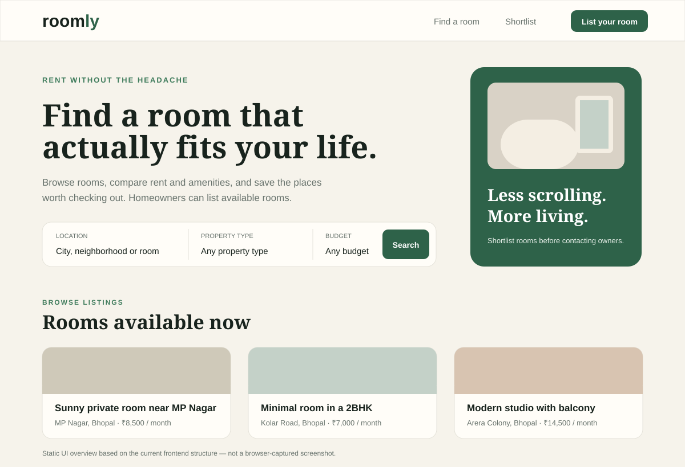

# Roomlee — Room Rental Frontend Prototype

A single-page room-rental marketplace frontend built with HTML, CSS and JavaScript.

*The image above is a static layout overview based on the current frontend. It is not a browser-captured screenshot.*

## Features

- Browse sample room listings
- Search by city, area or listing title
- Filter by property type and monthly rent
- Sort listings by rent
- Save and remove rooms from a shortlist
- Open listing details
- Add a sample room listing through a form
- Responsive layout for smaller screens

## Run locally

Open `index.html` in a browser. No build step is required.

## Current limitations

- Listings and saved rooms are stored in browser local storage.
- The included listings are demonstration data.
- Contact-owner action is a demo notification only.
- There is no backend, authentication, database or real messaging flow.
- Adding a listing does not publish it to a shared service or make it visible to other users.

This repository is a frontend prototype, not a production rental platform.
